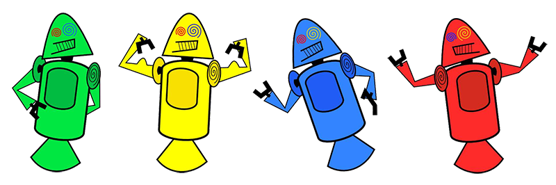

# Curiosidades do Mundo Tech

Site de uma página sobre a história do mascote do Android, feito com **HTML e CSS puros**, sem frameworks.

🔗 **Acesse:** https://miguel-wanzeler.github.io/Curiosidades-Tech/



## Sobre o projeto

O artigo conta como surgiu o mascote do Android: dos primeiros rascunhos (os *Dandroids*, de Dan Morrill) ao *Bugdroid*, criado por Irina Blok e inspirado nos símbolos de porta de banheiro. Também traz a lista de versões do Android nomeadas com doces, do Cupcake ao Pie.

Projeto desenvolvido durante o curso de HTML e CSS do [Curso em Vídeo](https://www.cursoemvideo.com).

## Tecnologias

- HTML5 semântico (`header`, `nav`, `main`, `article`, `aside`, `footer`)
- CSS3 com variáveis, Flexbox e `media queries`
- Imagens responsivas com `<picture>`
- Vídeo do YouTube incorporado com proporção 16:9
- Publicação com GitHub Pages

## Estrutura

```
Curiosidades-Tech/
├── index.html
├── css/
│   └── style.css
└── pacote-projeto-d010/
    ├── imagens/
    └── fontes/
```

## Como rodar localmente

```bash
git clone https://github.com/Miguel-Wanzeler/Curiosidades-Tech.git
cd Curiosidades-Tech
```

Depois, é só abrir o `index.html` no navegador.

## Autor

Feito por **Miguel** — [GitHub](https://github.com/Miguel-Wanzeler)
